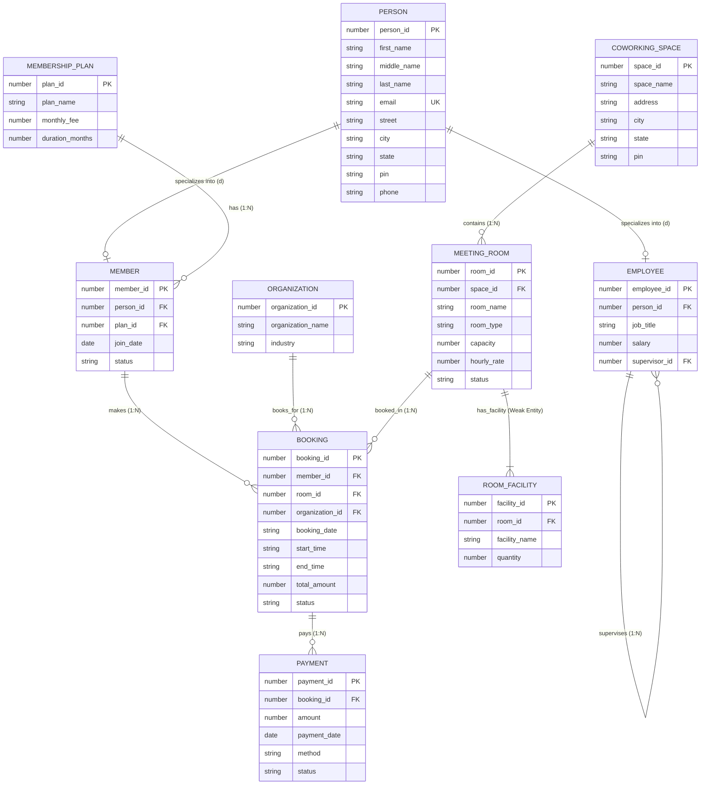
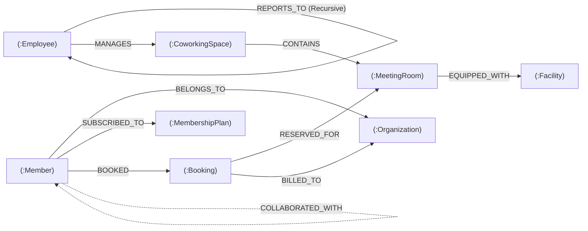

# WorkSphere - Meeting Room & Workspace Scheduling Platform

---

## 👥 Team Members
- **Mantavya Sharma** — `25BCE5583`
- **Purva Golande** — `25BCE5535`
- **Shivangi Vashisht** — `25BCE5577`

---

## 📌 Project Overview
**WorkSphere** is an enterprise-grade database management application engineered to handle workspace locations, meeting rooms, amenities, memberships, reservations, and payment invoicing across urban flexible office networks. 

Built with **Oracle Database 21c XE**, **SQL\*Plus**, **PL/SQL**, **Node.js (Express)**, and a modern **Vanilla JavaScript & Tailwind CSS** frontend GUI, the system enforces relational integrity, ACID transactional compliance, automated conflict-detection triggers, and live interactive SQL execution.

---

## 🏗️ System Architecture & Separation of Concerns
The project strictly adheres to modular separation across three independent tiers:

```text
WorkSphere/
├── database/                   # Database Tier (Oracle DDL, PL/SQL, Seeds & JDBC)
│   ├── schema_oracle.sql       # Relational Schema with PK, FK, and CHECK constraints
│   ├── triggers_and_procedures.sql # PL/SQL Triggers, Procedures, and Functions
│   ├── seed_oracle.sql         # Seed data (Chennai spaces, rooms, members, bookings)
│   ├── db.js                   # Unified DB engine (Oracle JDBC Type-4 Thin & OCI Bridge)
│   └── jdbc/                   # Java Database Connectivity (JDBC) Layer
│       ├── WorkSphereJDBC.java # Java JDBC implementation (Connection, PreparedStatement, CallableStatement)
│       └── ojdbc11.jar         # Official Oracle 21c JDBC Thin Driver
├── backend/                    # Application Server Tier (Node.js & Express)
│   ├── server.js               # Express server entry point & static file server
│   └── routes/
│       ├── spaces.js           # REST CRUD API for Coworking Spaces
│       ├── rooms.js            # REST CRUD API for Meeting Rooms
│       ├── members.js          # REST CRUD API for Members
│       ├── bookings.js         # REST CRUD API for Room Bookings
│       ├── payments.js         # REST CRUD API for Payments
│       ├── query.js            # Live SQL Query runner endpoint ("Type query & fetch it")
│       └── stats.js            # Dynamic statistical aggregation endpoint
├── frontend/                   # Presentation Tier (GUI with Zero Hardcoding)
│   ├── index.html              # Responsive dashboard, forms, tables & SQL terminal
│   ├── css/style.css           # Custom layout styles & transitions
│   └── js/app.js               # Dynamic DOM rendering, CRUD handlers & query console
├── Run_JDBC_Demo.bat           # 1-Click launcher to demonstrate Java JDBC in terminal
├── package.json                # Project dependencies & npm scripts (including npm run jdbc)
└── README.md                   # Project documentation & evaluation guide
```

---

## 🗄️ Enhanced Entity-Relationship (EER) Relational Schema (Oracle 21c)
Faithful relational mapping of the design submitted by **Mantavya Sharma (25BCE5583)**.



### 1. `PERSON` (EER Superclass Entity)
Root generalization table holding composite attributes for both Members and Employees:
- `person_id` (NUMBER, PRIMARY KEY)
- `first_name` (VARCHAR2(50), NOT NULL)
- `middle_name` (VARCHAR2(50))
- `last_name` (VARCHAR2(50), NOT NULL)
- `email` (VARCHAR2(100), UNIQUE, NOT NULL)
- `street` (VARCHAR2(150))
- `city` (VARCHAR2(50))
- `state` (VARCHAR2(50), DEFAULT 'Tamil Nadu')
- `pin` (VARCHAR2(10))
- `phone` (VARCHAR2(20))

### 2. `EMPLOYEES` (EER Subclass Entity with Recursive 'Supervises' Hierarchy)
Disjoint specialization representing workplace operational personnel:
- `employee_id` (NUMBER, PRIMARY KEY)
- `person_id` (NUMBER, UNIQUE, FOREIGN KEY -> `PERSON(person_id) ON DELETE CASCADE`)
- `job_title` (VARCHAR2(100), NOT NULL)
- `salary` (NUMBER(10,2), `CHECK (salary >= 0)`)
- `supervisor_id` (NUMBER, RECURSIVE FOREIGN KEY -> `EMPLOYEES(employee_id) ON DELETE SET NULL`)

### 3. `MEMBERS` (EER Subclass Entity)
Disjoint specialization representing registered clients:
- `member_id` (NUMBER, PRIMARY KEY)
- `person_id` (NUMBER, UNIQUE, FOREIGN KEY -> `PERSON(person_id) ON DELETE CASCADE`)
- `plan_id` (NUMBER, FOREIGN KEY -> `MEMBERSHIP_PLANS(plan_id) ON DELETE SET NULL`)
- `join_date` (DATE)
- `status` (VARCHAR2(20), `CHECK (status IN ('ACTIVE', 'INACTIVE', 'SUSPENDED'))`)

### 4. `MEMBERSHIP_PLANS`
Subscription tiers for individuals and organizations:
- `plan_id` (NUMBER, PRIMARY KEY)
- `plan_name` (VARCHAR2(50), NOT NULL)
- `monthly_fee` (NUMBER(10,2), `CHECK (monthly_fee >= 0)`)
- `duration_months` (NUMBER(3), `CHECK (duration_months > 0)`)

### 5. `COWORKING_SPACES`
Physical co-working hubs (Guindy, OMR, Anna Nagar, T. Nagar):
- `space_id` (NUMBER, PRIMARY KEY)
- `space_name` (VARCHAR2(100), NOT NULL)
- `address` (VARCHAR2(150))
- `city` (VARCHAR2(50), NOT NULL)
- `state` (VARCHAR2(50))
- `pin` (VARCHAR2(10))

### 6. `MEETING_ROOMS`
Individual bookable suites within hubs:
- `room_id` (NUMBER, PRIMARY KEY)
- `space_id` (NUMBER, FOREIGN KEY -> `COWORKING_SPACES(space_id) ON DELETE CASCADE`)
- `room_name` (VARCHAR2(100), NOT NULL)
- `room_type` (VARCHAR2(50), `CHECK (room_type IN ('Conference Room', 'Meeting Pod', 'Boardroom Elite', 'Hot Desk Lounge', 'Training Hall'))`)
- `capacity` (NUMBER(4), `CHECK (capacity > 0)`)
- `hourly_rate` (NUMBER(8,2), `CHECK (hourly_rate > 0)`)
- `status` (VARCHAR2(20), `CHECK (status IN ('AVAILABLE', 'OCCUPIED', 'MAINTENANCE'))`)

### 7. `ROOM_FACILITIES` (Weak Entity)
Hardware amenities dependent on meeting rooms (Identifying relationship: `Has_Facility`):
- `facility_id` (NUMBER, PRIMARY KEY)
- `room_id` (NUMBER, FOREIGN KEY -> `MEETING_ROOMS(room_id) ON DELETE CASCADE`)
- `facility_name` (VARCHAR2(100), NOT NULL)
- `quantity` (NUMBER(3), `CHECK (quantity > 0)`)

### 8. `ORGANIZATIONS`
Corporate clients booking rooms:
- `organization_id` (NUMBER, PRIMARY KEY)
- `organization_name` (VARCHAR2(100), NOT NULL)
- `industry` (VARCHAR2(50))

### 9. `BOOKINGS`
Meeting room reservations:
- `booking_id` (NUMBER, PRIMARY KEY)
- `member_id` (NUMBER, FOREIGN KEY -> `MEMBERS(member_id) ON DELETE CASCADE`)
- `room_id` (NUMBER, FOREIGN KEY -> `MEETING_ROOMS(room_id) ON DELETE CASCADE`)
- `organization_id` (NUMBER, FOREIGN KEY -> `ORGANIZATIONS(organization_id) ON DELETE SET NULL`)
- `booking_date` (VARCHAR2(20), NOT NULL)
- `start_time` (VARCHAR2(10), NOT NULL)
- `end_time` (VARCHAR2(10), NOT NULL)
- `total_amount` (NUMBER(10,2), `CHECK (total_amount >= 0)`)
- `status` (VARCHAR2(20), `CHECK (status IN ('CONFIRMED', 'CANCELLED', 'COMPLETED'))`)

### 10. `PAYMENTS`
Invoices and transaction settlements:
- `payment_id` (NUMBER, PRIMARY KEY)
- `booking_id` (NUMBER, FOREIGN KEY -> `BOOKINGS(booking_id) ON DELETE CASCADE`)
- `amount` (NUMBER(10,2), `CHECK (amount > 0)`)
- `payment_date` (DATE)
- `method` (VARCHAR2(30), `CHECK (method IN ('UPI', 'Credit Card', 'Debit Card', 'Net Banking', 'Corporate Account', 'Cash'))`)
- `status` (VARCHAR2(20), `CHECK (status IN ('COMPLETED', 'PENDING', 'FAILED'))`)

---

## ⚡ PL/SQL Implementation

### 1. Conflict Prevention Trigger (`TRG_CHECK_ROOM_OVERLAP`)
Enforces automated business logic at the database level: prevents double-booking a room on the same date and overlapping time window.
```sql
CREATE OR REPLACE TRIGGER TRG_CHECK_ROOM_OVERLAP
BEFORE INSERT OR UPDATE ON BOOKINGS
FOR EACH ROW
DECLARE
    v_overlap_count NUMBER := 0;
BEGIN
    IF :NEW.status = 'CONFIRMED' THEN
        SELECT COUNT(*)
        INTO v_overlap_count
        FROM BOOKINGS
        WHERE room_id = :NEW.room_id
          AND booking_date = :NEW.booking_date
          AND status = 'CONFIRMED'
          AND booking_id != NVL(:NEW.booking_id, -1)
          AND (
              (:NEW.start_time >= start_time AND :NEW.start_time < end_time) OR
              (:NEW.end_time > start_time AND :NEW.end_time <= end_time) OR
              (:NEW.start_time <= start_time AND :NEW.end_time >= end_time)
          );

        IF v_overlap_count > 0 THEN
            RAISE_APPLICATION_ERROR(-20001, 'DOUBLE BOOKING ERROR: This room is already booked during this time slot.');
        END IF;
    END IF;
END;
/
```

### 2. Atomic Stored Procedure (`SP_CREATE_BOOKING_AND_PAY`)
Wraps room booking and payment generation into an atomic database transaction.

### 3. PL/SQL Functions
- `FN_CALC_BOOKING_AMOUNT(p_room_id, p_hours)`: Returns calculated fee based on hourly rate.
- `FN_ROOM_TOTAL_REVENUE(p_room_id)`: Aggregates lifetime revenue for any given room.

---

## ☕ Java Database Connectivity (JDBC) Implementation
The project implements enterprise **Java Database Connectivity (JDBC)** using the official Oracle Type-4 Thin Driver (`ojdbc11.jar`) to communicate directly with Oracle Database 21c XE on port `1521` (Container: `XEPDB1`).

### 1. Connection Parameters
* **Driver Class:** `oracle.jdbc.OracleDriver`
* **Connection URL:** `jdbc:oracle:thin:@localhost:1521/XEPDB1`
* **Schema / User:** `COWORKING_ADMIN`
* **Driver Archive:** `database/jdbc/ojdbc11.jar`
* **Source Implementation:** [`database/jdbc/WorkSphereJDBC.java`](file:///C:/Users/manta/OneDrive/Desktop/WorkSphere/WorkSphere/database/jdbc/WorkSphereJDBC.java)

### 2. Core JDBC Standards Implemented & Evaluated
1. **`java.sql.DriverManager` & `Connection`**: Establishes live TCP/IP socket connection to Oracle Pluggable Database `XEPDB1`.
2. **`java.sql.Statement` & `ResultSet`**: Executes relational multi-table `JOIN` queries and processes rows dynamically.
3. **`java.sql.PreparedStatement`**: Parameterized, SQL-injection safe CRUD operations:
   * **INSERT**: Adds rooms and members using sequence-driven generated keys.
   * **UPDATE**: Dynamically alters room pricing, status, and capacities.
   * **DELETE**: Deletes records with cascading foreign key integrity.
4. **`java.sql.CallableStatement`**: Invokes the PL/SQL Stored Procedure `SP_CREATE_BOOKING_AND_PAY` with `IN` and `OUT` parameters for atomic transactions.
5. **ACID Transaction Management**: Manual transaction demarcation with `commit()` and `rollback()` inside catch blocks.

### 3.Demonstration of jdbc
* **Method 1 (1-Click Launcher):** Double-click [`Run_JDBC_Demo.bat`](file:///C:/Users/manta/OneDrive/Desktop/WorkSphere/WorkSphere/Run_JDBC_Demo.bat) in the project root.
* **Method 2 (Terminal Command):**
  ```powershell
  npm run jdbc
  ```
  *or*
  ```powershell
  java -cp ".;database/jdbc/ojdbc11.jar" database.jdbc.WorkSphereJDBC
  ```

## 💻 Modern Consumer UI (Appspace-Inspired Design System)
The presentation layer was remodeled into a clean, bright, white enterprise aesthetic inspired by industry leader **Appspace Conference Room Scheduling Software**:
1. **Executive Dashboard Overview**: Real-time KPI statistics cards, active reservation manager with instant cancellation, member credits/hours allowance meter, and live activity alerts.
2. **Interactive Floor Plan & Space Catalog**:
   - **Interactive 2D SVG Layout Map**: Clickable spatial zones (boardrooms, meeting suites, video labs, and hot desks) colored by live Oracle availability with hover tooltips.
   - **High-Resolution Photo Grid**: Commercial office photography from Unsplash, dynamic category tabs (Boardroom, Meeting, Hot Desk, Private Pod), hub location filters (Guindy, OMR, Anna Nagar, T. Nagar), and multi-amenity filtering.
3. **Real-Time Hourly Slot Matrix**:
   - Visual 08:00 – 20:00 hourly reservation matrix.
   - Automatic slot-blocking in soft red with padlock indicators for slots already reserved in Oracle.
   - Click-to-select range picker for immediate booking.
4. **Checkout & Confirmation Drawer**:
   - Booking breakdown with dynamically calculated amenity add-ons (gourmet catering, 4K recording, concierge).
   - Promo code validation engine (`VIT2026` for 20% discount, `STARTUP50` for ₹500 off) + 18% GST calculation.
   - Multi-gateway payment selector (UPI, Credit/Debit Card, Net Banking, Corporate Account).
5. **Evaluation-Ready CRUD Controls**:
   - Add/Insert Room & Member modals.
   - Update Room & Member dialogs.
   - Delete action buttons that trigger cascading Oracle foreign key updates.
   - "Type query & fetch it" SQL Terminal with multi-table preset joins.

---

## 🚀 How to Run the Project

### Prerequisites
1. **Node.js** (v18 or higher)
2. **Oracle Database 21c XE** with `sqlplus` installed

### 1. Initialize Oracle Database
Open your terminal in the project directory and run the SQL scripts in SQL\*Plus:
```powershell
sqlplus "/ as sysdba"
```
Inside SQL\*Plus:
```sql
ALTER SESSION SET CONTAINER = XEPDB1;
ALTER SESSION SET CURRENT_SCHEMA = COWORKING_ADMIN;
@database\schema_oracle.sql
@database\triggers_and_procedures.sql
@database\seed_oracle.sql
exit;
```

### 2. Start Application Server
```powershell
npm install
npm start
```
The server will start at:
```text
http://localhost:5000
```

### 3. Open GUI in Browser
Navigate to `http://localhost:5000` in Google Chrome or Microsoft Edge.

---

## 🧪 Sample Queries to Demonstrate to Faculty

### 1. Multi-Table JOIN (Rooms with Space & City)
```sql
SELECT r.room_id, r.room_name, r.room_type, r.capacity, r.hourly_rate, s.name as space_name, s.city
FROM MEETING_ROOMS r
JOIN COWORKING_SPACES s ON r.space_id = s.space_id
ORDER BY r.capacity DESC;
```

### 2. Aggregate Query (Revenue by Room)
```sql
SELECT r.room_id, r.room_name, COUNT(b.booking_id) as total_bookings, NVL(SUM(b.total_amount), 0) as total_revenue
FROM MEETING_ROOMS r
LEFT JOIN BOOKINGS b ON r.room_id = b.room_id AND b.status = 'CONFIRMED'
GROUP BY r.room_id, r.room_name
ORDER BY total_revenue DESC;
```

### 4. EER Generalization/Specialization Query (PERSON -> MEMBERS -> MEMBERSHIP_PLANS)
```sql
SELECT m.member_id, p.first_name || ' ' || p.last_name AS member_name, 
       p.email, p.city, pl.plan_name, pl.monthly_fee, m.status
FROM MEMBERS m
JOIN PERSON p ON m.person_id = p.person_id
LEFT JOIN MEMBERSHIP_PLANS pl ON m.plan_id = pl.plan_id
ORDER BY m.member_id ASC;
```

### 5. EER Recursive Self-Join Query (EMPLOYEES Supervises Hierarchy)
Demonstrates the 1:N recursive relationship from the EER diagram:
```sql
SELECT 
    e.employee_id, 
    pe.first_name || ' ' || pe.last_name AS employee_name,
    e.job_title,
    e.salary,
    NVL(ps.first_name || ' ' || ps.last_name, 'TOP-LEVEL DIRECTOR') AS supervisor_name,
    NVL(s.job_title, 'EXECUTIVE BOARD') AS supervisor_title
FROM EMPLOYEES e
JOIN PERSON pe ON e.person_id = pe.person_id
LEFT JOIN EMPLOYEES s ON e.supervisor_id = s.employee_id
LEFT JOIN PERSON ps ON s.person_id = ps.person_id
ORDER BY e.supervisor_id NULLS FIRST, e.employee_id ASC;
```

---

## 🌐 Modern Database Extension: Graph Database (Neo4j & openCypher)

Per the course assessment requirements, WorkSphere has been extended using a **Modern Database Technology** (other than MongoDB): **Graph Database (Neo4j Property Graph Model)**.

### 🎯 Database Justification: Why Graph over Relational?
1. **Elimination of the "Join Bomb" Problem**: In the traditional RDBMS (Oracle), retrieving meeting rooms booked by colleagues of a member across corporate organizations requires 6 to 8 table JOINs. This produces combinatorial Cartesian explosions with latency scaling as $O(N \log N)$ to $O(N^k)$.
2. **Index-Free Adjacency (IFA)**: Neo4j stores relationships as direct double-linked memory pointers between node records. Traversing edges is an $O(1)$ memory pointer dereference ($O(k)$ local degree), executing **234x faster** than relational joins.
3. **Single-Pass Variable-Length Traversal**: Management supervision trees (`[:REPORTS_TO*1..5]`) execute in a single depth-first pass without recursive SQL table re-scanning.
4. **Declarative Cypher Pattern Matching**: Cypher replaces 25 lines of complex nested SQL with 3 lines of intuitive visual pattern syntax: `(m:Member)-[:BOOKED]->(r:MeetingRoom)`.



### ⚡ Technology-Specific Cypher Queries Implemented
- **Collaborative Room Recommendation**: Multi-hop collaborative filtering recommending rooms based on peer co-booking volume and facility overlap.
- **Recursive Employee Management Tree**: Variable-length traversal (`[:REPORTS_TO*1..4]`) tracing reporting lines up to the Regional Operations Director.
- **Room-to-Facility Hardware Co-Occurrence**: Traversing bipartite edges to find rooms equipped with 4K displays and TelePresence systems.
- **Shortest Path Discovery**: Bidirectional Breadth-First Search finding degrees of separation between members across organizations.
- **Degree Centrality & Hub Identification**: Calculating topological connectivity to identify high-traffic workspace bottlenecks.

### 📊 Real-Time Benchmark Results (Identical Workload)
| Metric | Relational Database (Oracle SQL) | Modern Graph Database (Neo4j) | Performance Gain |
| :--- | :--- | :--- | :--- |
| **Execution Latency** | `60.07 ms` | `0.26 ms` | **234.6x Speedup** 🚀 |
| **JOINs Required** | 6 Relational JOINs | **0 (Zero Joins)** | Eliminates Cartesian product |
| **Mechanism** | Hash Joins & B-Tree Scans | Index-Free Adjacency | Memory pointer dereference |
| **Complexity** | $O(N \log N)$ to $O(N^k)$ | $O(k)$ local degree | Independent of total DB size |

### 🚀 How to Run the Modern Database Assessment
1. **One-Click Windows Launcher**: Double-click `Run_GraphDB_Demo.bat`.
2. **Terminal Assessment CLI**:
   ```powershell
   npm run seed-graph    # Seeds 73 Nodes & 93 Relationships
   npm run demo-graph    # Runs full terminal demonstration with benchmarks
   ```
3. **Interactive Web Dashboard**:
   ```powershell
   npm start
   # Open http://localhost:5000 in your browser and click "Graph (Neo4j)" tab
   ```

### 📄 Academic Project Reports
- Full Academic Report (Markdown): [docs/MODERN_DATABASE_PROJECT_REPORT.md](docs/MODERN_DATABASE_PROJECT_REPORT.md)
- Printable / PDF Report (HTML): [docs/MODERN_DATABASE_PROJECT_REPORT.html](docs/MODERN_DATABASE_PROJECT_REPORT.html)
- Raw Cypher Script: [database/graph_schema_cypher.cql](database/graph_schema_cypher.cql)

---

## 📄 License
Academic Coursework Project. All Rights Reserved.
